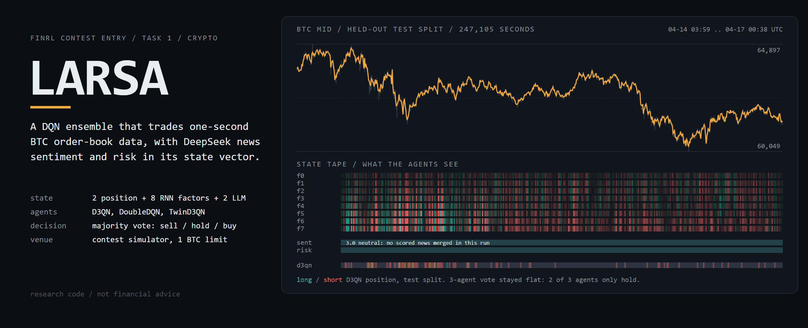
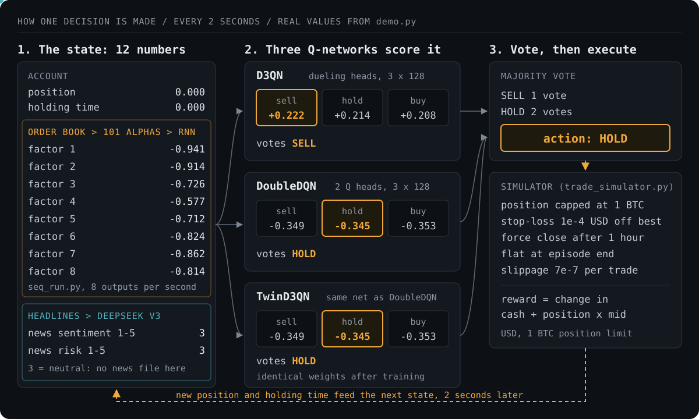
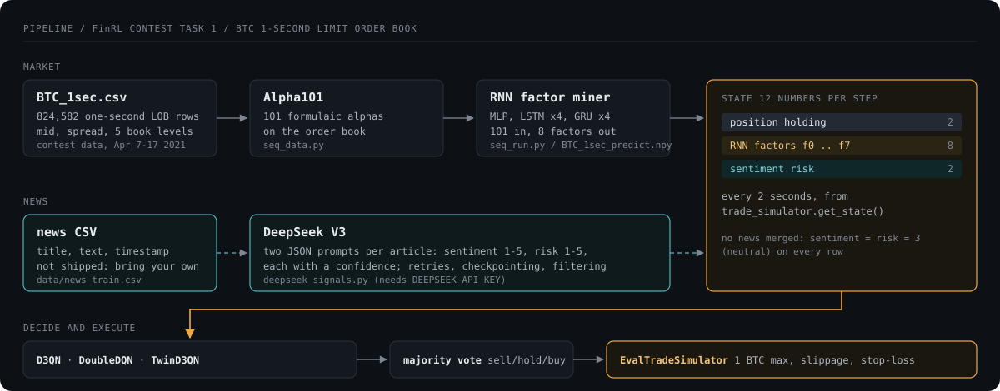
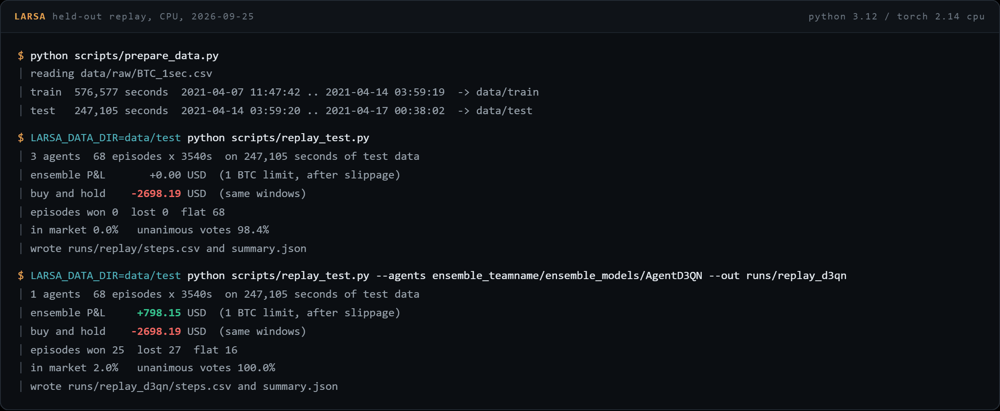
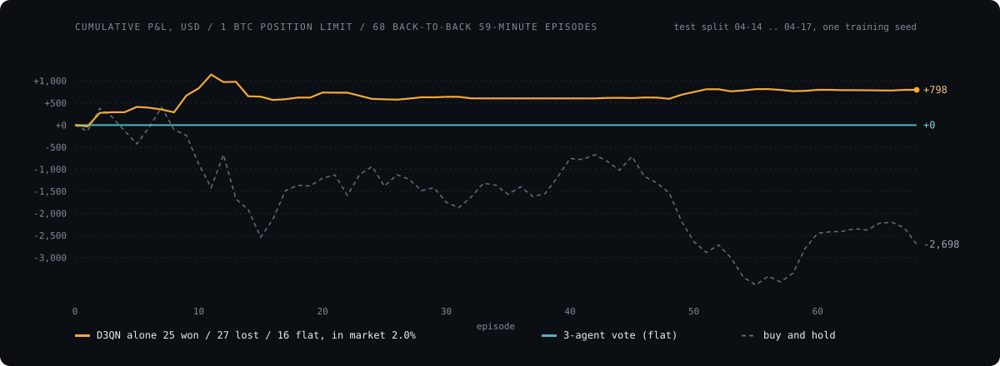

<picture>
  <source media="(prefers-color-scheme: light)" srcset="assets/hero-light.png">
  
</picture>

# FinRL DeepSeek Crypto Trading (LARSA)

**Three small AI agents that learned to buy, sell or hold Bitcoin every 2 seconds, plus an honest replay of how they did.**

For people learning deep reinforcement learning for trading, FinRL contest entrants, and anyone curious how an LLM news-sentiment signal plugs into a trading agent.

LARSA is a crypto trading bot research project for Task 1 of the FinRL contest: a DQN ensemble (D3QN, DoubleDQN, TwinD3QN) trained on one-second Bitcoin limit order book data, with DeepSeek LLM sentiment and risk scores in the state. The agents vote sell, hold or buy, and the contest's market-replay simulator executes the vote.

[](https://github.com/mattbusel/FinRL_DeepSeek_Crypto_Trading/actions/workflows/ci.yml) &nbsp; **[Project page](https://mattbusel.github.io/FinRL_DeepSeek_Crypto_Trading/)**

> [!WARNING]
> **Research code, not financial advice.** Nothing here has been tested with real money, and the results come from one training seed on nine days of 2021 data. Crypto trading can lose all of the capital you put in.

## Try it in one command

No download, no API key, about 15 seconds on a laptop CPU. It replays the trained agents over 4 bundled hours of the real contest test data:

```bash
git clone https://github.com/mattbusel/FinRL_DeepSeek_Crypto_Trading && cd FinRL_DeepSeek_Crypto_Trading
pip install -r requirements-demo.txt && python demo.py
```

<details open>
<summary>Real output (2026-09-28, Python 3.12, CPU)</summary>

```text
LARSA demo: 3 DQN agents trading BTC on the contest's 1-second order book
data   17,762 seconds from the held-out test split, 4 episodes x 3540 s
price  63,313.23 -> 62,300.00 USD over the traded hours
agents AgentD3QN, AgentDoubleDQN, AgentTwinD3QN (trained 2026-09-25, CPU)

1) ONE DECISION, TAKEN APART

   episode 1, second 3,642, BTC mid 63,321.23
   state the agents see (12 numbers):
           position +0.000     holding time +0.000     RNN factor 1 -0.941     RNN factor 2 -0.914
       RNN factor 3 -0.726     RNN factor 4 -0.577     RNN factor 5 -0.712     RNN factor 6 -0.824
       RNN factor 7 -0.862     RNN factor 8 -0.814   news sentiment +3.000        news risk +3.000
   each agent scores sell / hold / buy, then votes for its highest score:
    AgentD3QN       sell +0.222  hold +0.214  buy +0.208   -> SELL
    AgentDoubleDQN  sell -0.349  hold -0.345  buy -0.353   -> HOLD
    AgentTwinD3QN   sell -0.349  hold -0.345  buy -0.353   -> HOLD
   majority vote -> HOLD (simulator then applies position limit, stop-loss, slippage)

2) THE SAME HOURS, REPLAYED  (USD P&L, 1 BTC position limit, after slippage)
   episode    3-agent vote   D3QN alone   buy and hold
   1                 +0.00      +308.41        -531.06
   2                 +0.00      -169.21        +743.33
   3                 +0.00        +8.62       -1000.34
   4                 +0.00      -328.78        -242.11
   total             +0.00      -180.95       -1030.18

   3-agent vote: unanimous on 92.9% of steps. DoubleDQN and TwinD3QN learned
   'always hold', so they outvote D3QN every time and the ensemble never trades.
   TwinD3QN is built on the same QNetTwin network as DoubleDQN (erl_agent.py) and,
   trained with the same seed, has bit-identical weights: one vote counted twice.
   D3QN alone: sell 619, hold 6389, buy 72 of 7080 steps, in the market 7.4% of the time.
   4 hours is an anecdote. The full 68-hour test replay is in the README.

3) per-step log of the 3-agent run: runs/demo/steps.csv

Research code, not financial advice.
```
</details>

## How one decision is made



- **The state** (`trade_simulator.py`, `get_state`): your position and holding time, 8 factors that an RNN squeezes out of 101 order-book alphas, and the latest DeepSeek sentiment and risk score (1 to 5, neutral 3 when there is no headline).
- **The agents** (`erl_net.py`): each is a 3-layer, 128-wide network that gives sell, hold and buy a score. Each votes for its highest score.
- **The vote and the simulator** (`scripts/replay_test.py`, `trade_simulator.py`): the majority wins, then the simulator caps the position at 1 BTC, stops out on any move against the best price, closes after an hour, charges slippage and books the change in value as the reward.
- **What the demo reveals:** D3QN wants to trade, the other two learned to always hold, and TwinD3QN turned out to be an exact copy of DoubleDQN, so the ensemble never trades. That is a real finding about this run, not a bug in the demo.

The whole pipeline, from raw data to a vote:



## Results on the full test split (68 hours)

The same agents over the whole held-out 30% of the data, run on 2026-09-25 with the [3 steps below](#reproduce-the-full-run-in-3-steps) (Python 3.12, torch 2.14 CPU):





What the numbers say, and what they do not:

| | P&L, USD per 1 BTC limit | Episodes won / lost / flat | Time in market |
|---|---:|---|---:|
| 3-agent majority vote | 0.00 | 0 / 0 / 68 | 0.0% |
| D3QN on its own | +798.15 | 25 / 27 / 16 | 2.0% |
| Buy and hold, same windows | -2,698.19 | | 100% |

- **The ensemble never traded.** DoubleDQN and TwinD3QN converged to "always hold" in this run (their evaluation return stayed at 0.00 through training), so they outvote D3QN on every step. `task1_eval.py` on the same agents reports Sharpe `inf` and drawdown `0.0` for the same reason: no trades, no variance.
- **D3QN alone** was mostly short (sell on 2.3% of steps, buy on 0.2%) during three days when BTC fell from 63,734 to 61,371. Winning and losing episodes are nearly even. One seed, one period, no transaction-cost stress test: treat it as a working pipeline, not an edge.
- The replay walks the whole test split in 68 back-to-back 59-minute episodes with the contest's own `EvalTradeSimulator` (1 BTC limit, 7e-7 slippage, stop-loss, forced flat at episode end), so it is deterministic. Per-step votes, positions and rewards are in `runs/replay*/steps.csv`.

## Reproduce the full run in 3 steps

Runs on a laptop CPU. The market data is public: the contest organisers host it on Google Drive (1.4 GB).

```bash
git clone https://github.com/mattbusel/FinRL_DeepSeek_Crypto_Trading
cd FinRL_DeepSeek_Crypto_Trading
pip install torch --index-url https://download.pytorch.org/whl/cpu
pip install numpy pandas scipy matplotlib pydantic pydantic-settings pyyaml openai gdown

# 1. download BTC_1sec.csv + BTC_1sec_predict.npy, split 70/30 in time
python scripts/prepare_data.py --download --source data/raw

# 2. train D3QN, DoubleDQN and TwinD3QN on the first 70%  (about 30 min on CPU)
LARSA_DATA_DIR=data/train NUM_SIMS=256 RL_BREAK_STEP=60000 python task1_ensemble.py

# 3. replay the ensemble over the last 30%, hour by hour
LARSA_DATA_DIR=data/test python scripts/replay_test.py
```

On Windows PowerShell set the variables with `$env:LARSA_DATA_DIR = "data/train"` first. Without a news file every row gets the neutral LLM signal 3 (see [News signals](docs/REFERENCE.md#news-signals-deepseek)).

## Documentation

| Read this | For |
|---|---|
| [docs/REFERENCE.md](docs/REFERENCE.md) | Every file and stage, DeepSeek news signals, all configuration variables, metrics, extra modules, tests |
| [docs/architecture.md](docs/architecture.md) | Module by module design notes |
| [CHANGELOG.md](CHANGELOG.md) | What changed and when |
| [CONTRIBUTING.md](CONTRIBUTING.md) | How to run the tests and send a change |

## License

MIT, see [LICENSE](LICENSE). Built on the [FinRL Contest 2024 Task 1 starter kit](https://github.com/Open-Finance-Lab/FinRL_Contest_2024/tree/main/Task_1_starter_kit) (ElegantRL agents and market-replay simulator) from the Open Finance Lab.

Author: Matthew C. Busel ([mattbusel@gmail.com](mailto:mattbusel@gmail.com), [github.com/mattbusel](https://github.com/mattbusel))
