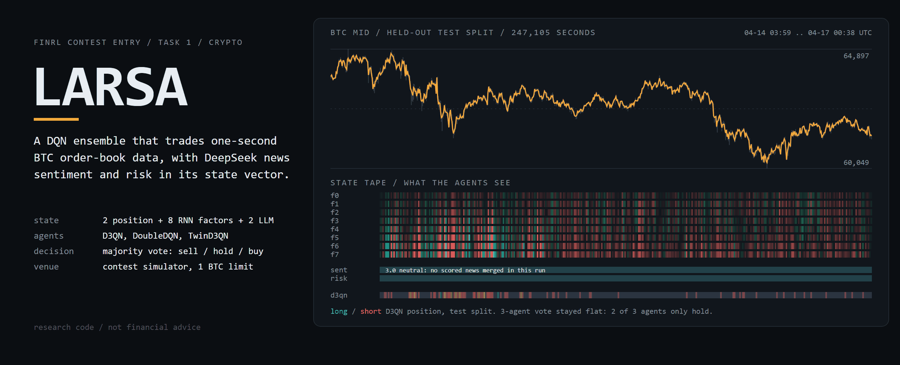
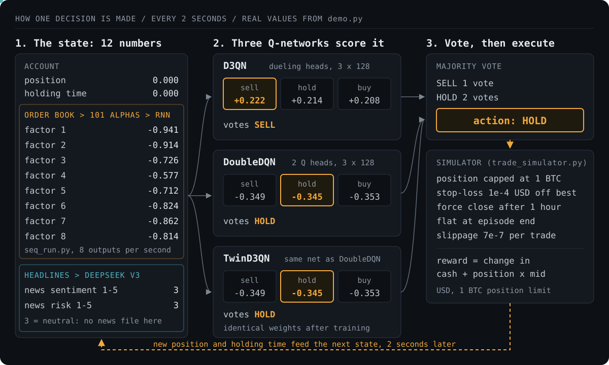
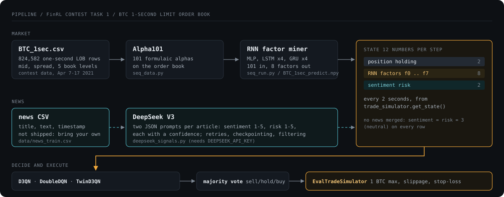
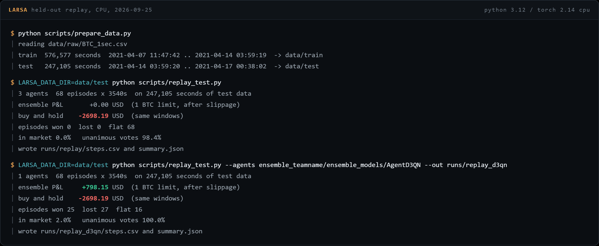
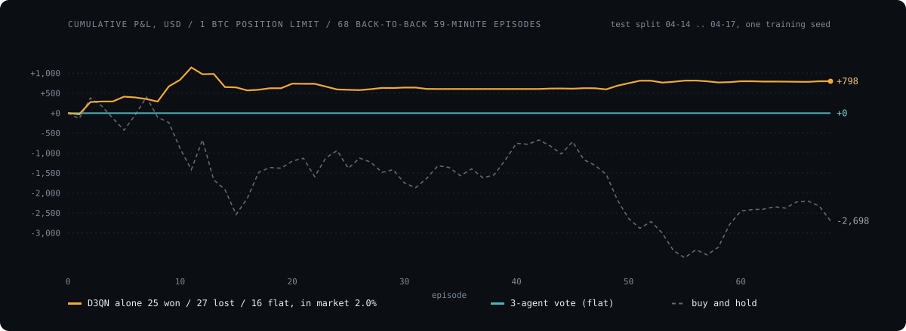

# FinRL DeepSeek Crypto Trading (LARSA): details

Everything cut from the short [README](../README.md), kept word for word.

<picture>
  <source media="(prefers-color-scheme: light)" srcset="../assets/hero-light.png">
  
</picture>


<!-- outcome-block -->
**A crypto trading agent that reads the news. DeepSeek V3 scores BTC headlines for sentiment and risk, and those scores feed a team of DQN agents.**

Price-only agents miss shifts driven by news. This one puts news scores into every decision.

If it doesn't do what this README says, [open an issue](https://github.com/Mattbusel/FinRL_DeepSeek_Crypto_Trading/issues) and I'll fix it.
<!-- outcome-block -->


**Three small AI agents that learned to buy, sell or hold Bitcoin every 2 seconds. Plus an honest replay of how they did.**

LARSA is my entry for Task 1 of the FinRL contest. Three DQN agents (D3QN, DoubleDQN, TwinD3QN) trained on one-second Bitcoin order book data, with DeepSeek sentiment and risk scores in what they see. They vote sell, hold or buy. The contest's replay simulator runs the vote.

&nbsp; **[Project page](https://finrl-deepseek-crypto-trading.vercel.app/)**

> [!WARNING]
> **Research code, not financial advice.** Never tested with real money. Results come from one training seed on nine days of 2021 data. Crypto trading can lose everything you put in.

## Try it in one command

No download, no API key, about 15 seconds on a laptop CPU. Replays the trained agents over 4 bundled hours of real contest test data:

```bash
git clone https://gitlab.com/mattbusel/FinRL_DeepSeek_Crypto_Trading && cd FinRL_DeepSeek_Crypto_Trading
pip install -r requirements-demo.txt && python demo.py
```

<details open>
<summary>Real output (2026-09-28, Python 3.12, CPU)</summary>

```text
LARSA demo: 3 DQN agents trading BTC on the contest's 1-second order book
data   17,762 seconds from the held-out test split, 4 episodes x 3540 s
price  63,313.23 -> 62,300.00 USD over the traded hours
agents AgentD3QN, AgentDoubleDQN, AgentTwinD3QN (trained 2026-09-25, CPU)

1) ONE DECISION, TAKEN APART

   episode 1, second 3,642, BTC mid 63,321.23
   state the agents see (12 numbers):
           position +0.000     holding time +0.000     RNN factor 1 -0.941     RNN factor 2 -0.914
       RNN factor 3 -0.726     RNN factor 4 -0.577     RNN factor 5 -0.712     RNN factor 6 -0.824
       RNN factor 7 -0.862     RNN factor 8 -0.814   news sentiment +3.000        news risk +3.000
   each agent scores sell / hold / buy, then votes for its highest score:
    AgentD3QN       sell +0.222  hold +0.214  buy +0.208   -> SELL
    AgentDoubleDQN  sell -0.349  hold -0.345  buy -0.353   -> HOLD
    AgentTwinD3QN   sell -0.349  hold -0.345  buy -0.353   -> HOLD
   majority vote -> HOLD (simulator then applies position limit, stop-loss, slippage)

2) THE SAME HOURS, REPLAYED  (USD P&L, 1 BTC position limit, after slippage)
   episode    3-agent vote   D3QN alone   buy and hold
   1                 +0.00      +308.41        -531.06
   2                 +0.00      -169.21        +743.33
   3                 +0.00        +8.62       -1000.34
   4                 +0.00      -328.78        -242.11
   total             +0.00      -180.95       -1030.18

   3-agent vote: unanimous on 92.9% of steps. DoubleDQN and TwinD3QN learned
   'always hold', so they outvote D3QN every time and the ensemble never trades.
   TwinD3QN is built on the same QNetTwin network as DoubleDQN (erl_agent.py) and,
   trained with the same seed, has bit-identical weights: one vote counted twice.
   D3QN alone: sell 619, hold 6389, buy 72 of 7080 steps, in the market 7.4% of the time.
   4 hours is an anecdote. The full 68-hour test replay is in the README.

3) per-step log of the 3-agent run: runs/demo/steps.csv

Research code, not financial advice.
```
</details>

## How one decision is made



- **The state** (`trade_simulator.py`, `get_state`): position, holding time, 8 factors an RNN pulls from 101 order-book alphas, and the latest DeepSeek sentiment and risk score (1 to 5, 3 when there is no headline).
- **The agents** (`erl_net.py`): each is a 3-layer, 128-wide network that scores sell, hold and buy. Each votes for its top score.
- **The vote and the simulator** (`scripts/replay_test.py`, `trade_simulator.py`): majority wins. The simulator caps the position at 1 BTC, stops out on any move against the best price, closes after an hour, charges slippage, and books the change in value as the reward.
- **What the demo shows:** D3QN wants to trade. The other two learned to always hold. TwinD3QN is an exact copy of DoubleDQN. So the team never trades. That is a real result of this run, not a demo bug.

The whole pipeline, from raw data to a vote:



## Results on the full test split (68 hours)

Same agents over the full held-out 30% of the data, run 2026-09-25 with the [3 steps below](#reproduce-the-full-run-in-3-steps) (Python 3.12, torch 2.14 CPU):





What the numbers say, and what they don't:

| | P&L, USD per 1 BTC limit | Episodes won / lost / flat | Time in market |
|---|---:|---|---:|
| 3-agent majority vote | 0.00 | 0 / 0 / 68 | 0.0% |
| D3QN on its own | +798.15 | 25 / 27 / 16 | 2.0% |
| Buy and hold, same windows | -2,698.19 | | 100% |

- **The team never traded.** DoubleDQN and TwinD3QN settled on "always hold" (their eval return stayed 0.00 all through training). They outvote D3QN every step. `task1_eval.py` reports Sharpe `inf` and drawdown `0.0` for the same reason: no trades, no variance.
- **D3QN alone** was mostly short (sell 2.3% of steps, buy 0.2%) over three days when BTC fell from 63,734 to 61,371. Wins and losses are nearly even. One seed, one period, no cost stress test. It is a working pipeline, not an edge.
- The replay runs the full test split as 68 back-to-back 59-minute episodes in the contest's `EvalTradeSimulator` (1 BTC limit, 7e-7 slippage, stop-loss, flat at episode end). Same result every run. Per-step votes, positions and rewards are in `runs/replay*/steps.csv`.

## Reproduce the full run in 3 steps

Runs on a laptop CPU. The market data is public. The contest hosts it on Google Drive (1.4 GB).

```bash
git clone https://gitlab.com/mattbusel/FinRL_DeepSeek_Crypto_Trading
cd FinRL_DeepSeek_Crypto_Trading
pip install torch --index-url https://download.pytorch.org/whl/cpu
pip install numpy pandas scipy matplotlib pydantic pydantic-settings pyyaml openai gdown

# 1. download BTC_1sec.csv + BTC_1sec_predict.npy, split 70/30 in time
python scripts/prepare_data.py --download --source data/raw

# 2. train D3QN, DoubleDQN and TwinD3QN on the first 70%  (about 30 min on CPU)
LARSA_DATA_DIR=data/train NUM_SIMS=256 RL_BREAK_STEP=60000 python task1_ensemble.py

# 3. replay the ensemble over the last 30%, hour by hour
LARSA_DATA_DIR=data/test python scripts/replay_test.py
```

On Windows PowerShell, set variables first with `$env:LARSA_DATA_DIR = "data/train"`. With no news file, every row gets the neutral LLM score 3 (see [News signals](REFERENCE.md#news-signals-deepseek)).

## Documentation

| Read this | For |
|---|---|
| [docs/REFERENCE.md](REFERENCE.md) | Every file and stage, DeepSeek news signals, all configuration variables, metrics, extra modules, tests |
| [docs/architecture.md](architecture.md) | Module by module design notes |
| [CHANGELOG.md](../CHANGELOG.md) | What changed and when |
| [CONTRIBUTING.md](../CONTRIBUTING.md) | How to run the tests and send a change |

## License

MIT, see [LICENSE](../LICENSE). Built on the [FinRL Contest 2024 Task 1 starter kit](https://github.com/Open-Finance-Lab/FinRL_Contest_2024/tree/main/Task_1_starter_kit) (ElegantRL agents and market-replay simulator) from the Open Finance Lab.

Author: Matthew C. Busel ([mattbusel@gmail.com](mailto:mattbusel@gmail.com), [gitlab.com/mattbusel](https://gitlab.com/mattbusel))
